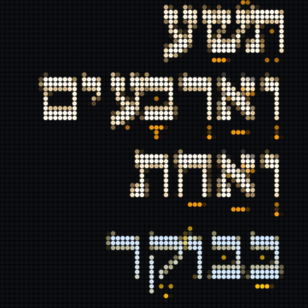
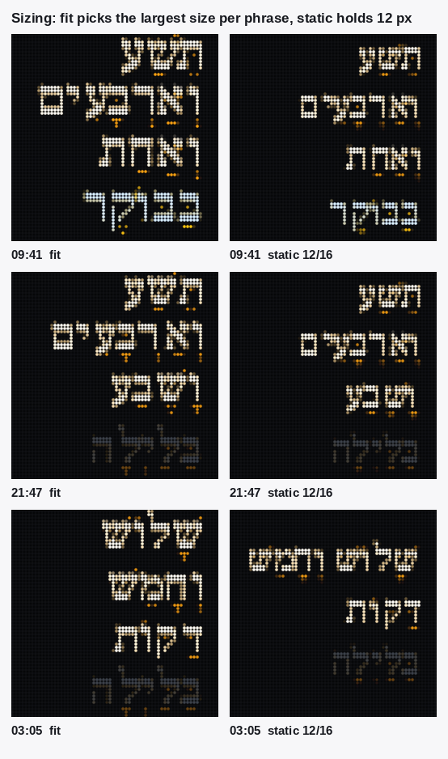
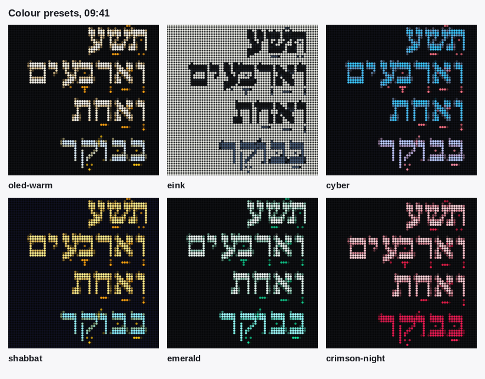

# tuneshine-shaon-millim

A Hebrew word clock for a 64x64 Tuneshine LED display.



Instead of digits, the panel writes the time out in Hebrew: *תשע וארבעים ואחת
בבוקר*. The sentence is laid out right to left with optional vowel points
(nikkud), and each line is sized by measurement so the text never runs off the
edge.

The program renders one 64x64 frame and uploads it to the panel as its idle
image. It runs once a minute from cron, or on demand.

## Credits

The idea is Matty Mariansky's, from this post:
<https://x.com/mmariansky/status/2023456756601417814?s=20>

The display is the [Tuneshine](https://tuneshine.io), a 64x64 LED panel made for
album art. Thank you to its maker for a device with an open local API, which is
what makes a project like this possible.

The font is [Frank Ruhl Libre](https://fonts.google.com/specimen/Frank+Ruhl+Libre)
by Yanek Iontef, used under the SIL Open Font Licence. The licence text is in
`fonts/OFL.txt`.

## Requirements

- Python 3.9 or newer.
- Pillow, built with libraqm. Raqm is what shapes Hebrew correctly, including the
  vowel points.
- A Tuneshine on the same network, reachable by HTTP.

```
pip install pillow
```

Check that Raqm is available before anything else:

```sh
python3 -c "from PIL import features; print(features.check('raqm'))"
```

It must print `True`. On Debian and Ubuntu, `python3-pil` from the distribution
usually has it. If it prints `False`, install `libraqm0` and reinstall Pillow from
source. Without Raqm the letters come out in the wrong order and the vowel points
land in the wrong place.

## Install

```sh
git clone https://github.com/tsella/tuneshine-shaon-millim.git
cd tuneshine-shaon-millim
pip install pillow
```

Nothing else to build. The font is bundled, so the clock works from a fresh
clone.

Copy the example config and edit the device address:

```sh
mkdir -p ~/.config/tuneshine-shaon-millim
cp config.example.json ~/.config/tuneshine-shaon-millim/config.json
```

Then find the panel:

```sh
python3 shaon_millim.py --discover
```

With no device in the config, `--push` runs discovery itself and uses whatever it
finds, so the two commands above are usually all the setup there is.

## Finding the panel

A Tuneshine advertises itself over multicast DNS as `_tuneshine._tcp.local`. The
clock listens for that answer, which gives it the address without anyone typing
one.

```sh
python3 shaon_millim.py --discover
```

```
Tuneshine 89B8   192.168.1.19   apiVersion=1 deviceId=... deviceName=Tom Sella's Tuneshine version=2.7.5
```

Discovery runs on two paths:

- `--discover` lists what it found and stops.
- `--push` uses discovery when `devices` in the config is empty, which is the
  default in `config.example.json`.

To pin one panel and skip discovery entirely, put its address in `devices`. Any of
these work:

- the IP, for example `192.168.1.19`
- the mDNS name, for example `tuneshine-89B8.local`
- `address:port` when the panel is not on port 80

```json
"devices": ["192.168.1.19"]
```

A pinned address costs one second less per run, and keeps working on a network
that blocks multicast. Discovery costs the timeout, four seconds by default, and
finds every panel, which is what you want if you have more than one.

If discovery finds nothing, check that the machine running cron can receive
multicast. Containers on a bridge network usually cannot, and some Wi-Fi
networks with client isolation drop it. Pin the address in that case.

## Configuration

`config.example.json` has every key. Blocks you leave out fall back to these
values.

| key | default | what it does |
|---|---|---|
| `devices` | `[]` | Panel addresses. Empty means discover them. |
| `mdns_timeout` | `4` | Seconds to listen for panels during discovery. |
| `label` | `"Hebrew word clock"` | Artist name shown on the device for this image. |
| `timezone` | `"local"` | `local`, or an IANA name such as `Asia/Jerusalem`. |
| `respect_playback` | `true` | Skip the upload while the panel is playing music. |
| `colors.preset` | `"oled-warm"` | One of the presets in [Colours](#colours). |
| `colors.background` | `null` | Hex override for the panel background. |
| `colors.letter` | `null` | Hex override for the letters. |
| `colors.nikkud` | `null` | Hex override for the vowel points. |
| `colors.period` | `null` | Hex override for the day-period word. |
| `colors.period_luminance` | `true` | Dim the day-period word. |
| `render.sizing` | `"fit"` | `fit` sizes each phrase; `static` holds one size. |
| `render.size` | `null` | Static only. `null` means 12. |
| `render.line_height` | `null` | Static only. `null` means size + 4. |
| `render.line_gap` | `2` | Fit only. Pixels between lines. |
| `render.nikkud` | `"color"` | `color`, `full`, or `none`. |
| `render.align` | `"right"` | `right` or `center`. |
| `render.antialias` | `true` | `false` snaps every pixel to a palette colour. |
| `fonts.path` | `null` | Font file to use. `null` means the bundled one. |
| `fonts.weight` | `null` | Named instance, for example `Bold`. |

A `null` in the colours block means "keep the preset's colour", not "no colour".

## The font

The clock needs a Hebrew font with vowel points. Frank Ruhl Libre ships in
`fonts/` and is the default, so there is nothing to do for normal use.

To use a different face, point `fonts.path` at the file:

```json
"fonts": { "path": "/usr/share/fonts/truetype/my-hebrew-font.ttf", "weight": null }
```

To install Frank Ruhl Libre for other programs on the machine, copy it into the
user font directory and refresh the cache:

```sh
mkdir -p ~/.local/share/fonts
cp fonts/FrankRuhlLibre-VF.ttf ~/.local/share/fonts/
fc-cache -f ~/.local/share/fonts
fc-list | grep -i "frank ruhl"
```

It is a variable font with a weight axis from 300 to 900. `fonts.weight` picks an
instance by name. The default is `Bold`, which holds up best at 12 pixels; a
lighter weight thins the strokes until the serifs break into single dots.

## Use

Render a frame to look at, without touching the panel:

```sh
python3 shaon_millim.py --time 09:41 --out frame.png
```

Push the current time to the panel:

```sh
python3 shaon_millim.py --push --config ~/.config/tuneshine-shaon-millim/config.json
```

With `devices` empty in the config, that discovers the panel first. To push to one
specific panel without discovery, add `--device 192.168.1.19`; repeat the flag for
several.

Render every preset to one sheet, to choose colours:

```sh
python3 shaon_millim.py --swatches swatches.png
```

Add a `--preset` or `--simulate` to any render to preview it as the panel will
show it:

```sh
python3 shaon_millim.py --time 21:47 --preset shabbat --simulate --out shabbat.png
```

The rendered frame reports what it did:

```
09:41  fit · 16px · 4 lines · widest 51/59px · 7 base chars  fits
colours: bg #050608  letters #FFF8EB  nikkud #F59E0B  period #94A3B8
```

`widest` against `limit` is the one number worth watching. If `fits` says
`OVERFLOWS`, the phrase is too long for the settings and the panel will clip it.

## Sizing

Two modes, set by `render.sizing`.

**`fit`** (default) picks the largest font size that seats the phrase. Short
hours get large text, long ones get smaller text. Nothing is ever clipped; the
size changes between minutes.

**`static`** holds one size and one line pitch for every minute. Set `size` and
`line_height`. Lines are placed by their vertical centre, so a line carrying
vowel points does not drag the block down.



The measured ceiling for static: 12 px with a 16 px line height seats all 168
times sampled, and 13 px at the same pitch also fits. At 12 px, a line height of
17 breaks 6 of those 168, and 18 breaks 42, because those phrases wrap to five
lines. Raising the size past 13 px at a 16 px pitch starts dropping frames too.

## Colours

Four layers can be coloured separately: the background, the letters, the vowel
points, and the day-period word (*בבוקר*, *בערב*, *בלילה*). Seven presets ship.



| preset | look |
|---|---|
| `oled-warm` | warm white letters, amber points, grey period. The default |
| `eink` | dark letters on paper grey, for a printed look |
| `cyber` | cyan letters, rose points, violet period |
| `shabbat` | amber letters on deep blue, with a blue period |
| `emerald` | near-white letters, green points |
| `crimson-night` | pale rose letters, crimson points |
| `dynamic` | changes with the hour of the day |
| `custom` | no preset colours; you supply all four |

Any layer can be overridden with a hex value, whatever the preset:

```json
"colors": {
  "preset": "oled-warm",
  "letter": "#E8F0FF",
  "nikkud": "#38BDF8"
}
```

A layer left at `null` keeps the preset's colour. `colors.period_luminance`
dims the day-period word so the time itself leads.

## How the Hebrew works

The time is spoken the way a person says it, not the way a form prints it.

- The hour uses the twelve-hour set. 15:00 is *שלוש*, not *חמש עשרה*.
- Minutes 1 to 19 are joined with a *ו* prefix, as in speech: *תשע וארבעים
  ואחת*.
- 1 minute is singular (*דקה*), 2 takes the dual (*שתי דקות*), 30 is *וחצי*.
- After 13:00 the day-period word is abbreviated to *אחה״צ* when the sentence is
  long enough to need the room, and spelled out when it is not.
- Midnight is *חצות* rather than *שתים עשרה בלילה*.

Vowel points have three modes. `color` draws the letters and the points in
different colours, which reads well on an LED panel because the two layers
separate by hue even where their brightness is close. `full` draws everything in
the letter colour. `none` drops the points and buys a larger font size.

## Panel behaviour

The frame is uploaded as an **idle** image, which is the same slot the device
uses when no music is playing. Two consequences:

- The panel keeps its normal behaviour. When music starts, the album art takes
  over by itself, and when playback stops the clock comes back.
- The upload never changes the device's brightness. If you want the panel dimmer
  at night, dim the frame in the render, not the device.

`respect_playback` (default `true`) checks `/state` before each upload and skips
the push while music is playing, so the clock does not fight the album art.

## Cron

Every minute is the right interval: the phrase only changes when the minute
changes.

```sh
crontab -e
```

```
* * * * * /usr/bin/python3 /opt/tuneshine-shaon-millim/shaon_millim.py --push --config /home/USER/.config/tuneshine-shaon-millim/config.json >/dev/null 2>&1
```

Cron does not read your shell profile, so use absolute paths. See
`crontab.example` for a commented copy.

The machine running cron must be online and on the same network as the panel.
Without it the clock stops updating and the panel keeps whatever frame it last
received, then falls back to its own idle image when it decides that frame is
stale.

## Tests

```sh
python3 test_shaon_millim.py
```

34 tests, about 3 seconds, no network and no panel. They check the phrase table
over every minute of the day, the fit guarantee, the static ceiling, the colour
parsing, the render option validation, and the font handling.

The images in `docs/` are generated by `python3 docs/make_images.py`.

## Troubleshooting

**The letters are in the wrong order.** Raqm is missing. See Requirements.

**`OVERFLOWS` in the render output.** The phrase does not fit at your settings.
Lower `render.size`, or go back to `render.sizing: "fit"`.

**`FAILED` with a connection error.** The panel is not reachable at that address.
Run `--discover` to see what it advertises, then either clear `devices` so
discovery is used, or pin the IP. mDNS resolution depends on the machine running
cron, and some minimal systems and container networks do not have it.

**`--discover` finds nothing.** The machine cannot receive multicast. Check from
another host on the same network, then pin the IP in `devices`.

**Nothing changes on the panel.** Check that no music is playing, since
`respect_playback` skips the upload while the device is showing album art.

## Licence

MIT. See `LICENSE`.

The font in `fonts/` is under the SIL Open Font Licence, not the MIT licence. See
`fonts/OFL.txt`.
